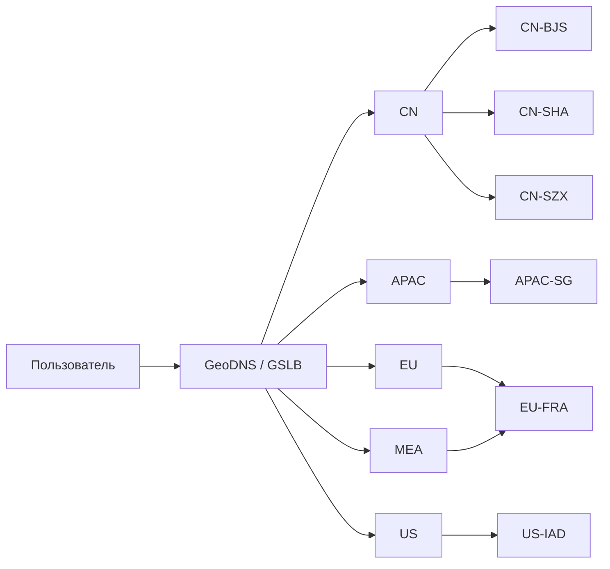
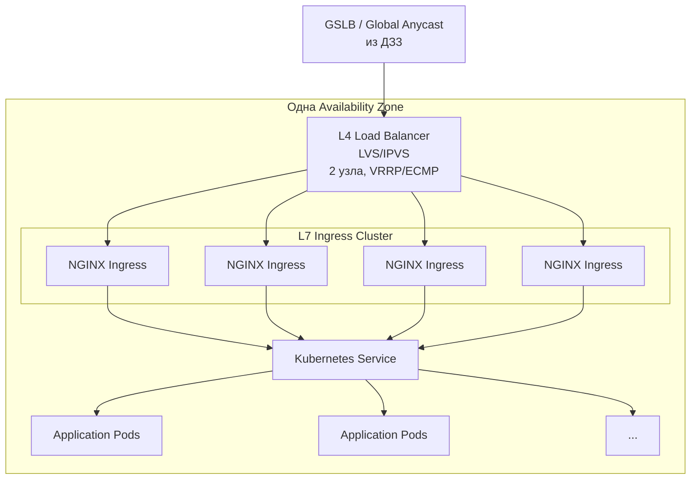
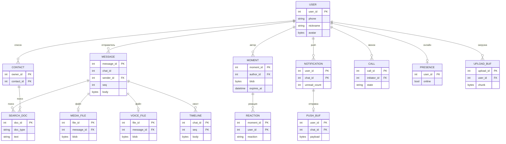

# Рассчётно-пояснительная записка для Курсовой работы по предмету "Проектирование высоконагруженных систем"

## 1. Тема и целевая аудитория

Тип сервиса: Мессенджер с поддержкой мультимедийных коммуникаций (видеозвонки) и социальных функций (аналог WeChat).

Основной функционал MVP:
* Авторизация и профиль пользователя: Регистрация по номеру телефона, управление контактами.
* Поиск (Search): Полнотекстовый поиск по контактам, диалогам и истории сообщений.
* Обмен сообщениями (Messaging): Передача текстовых, голосовых сообщений и медиафайлов (фото/видео/файлы) в личных и групповых чатах.
* Уведомления (Push Notifications): Гарантированная доставка пуш-уведомлений о новых сообщениях, вызовах и реакциях.
* Аудио- и видеозвонки: Сигнализация, установление и проведение личных и групповых звонков.
* Моменты (Сторисы): Публикация фото/видео контента на ограниченное время (доступно для просмотра только контактам)
* Отправка реакций на моменты.

Ключевые продуктовые решения:
* Гибридная архитектура видеосвязи (Использование P2P-соединений (WebRTC) для звонков и переключение на медиасерверы (SFU) при групповых звонках или плохом качестве сети).
* Строгая приватность контента: "Моменты" и реакции к ним доступны исключительно списку контактов пользователя.

Ключевые функции, характеризующие сервис:
1. Отправка и получение сообщений (текст, медиа, голос) со статусами доставки/прочтения.
2. Поиск по чатам, сообщениям и контактам.
3. Совершение аудио- и видеозвонков.
4. Создание "Моментов" (сторисов), просмотр ленты контактов и отправка реакций.
5. Доставка push-уведомлений о событиях.

Целевая аудитория:
* MAU (Месячная аудитория): 1.23 ≈ 1.2 млрд пользователей.
* DAU (Дневная аудитория): 1.09 ≈ 1.1 млрд пользователей.
* Географическое распределение: Глобальное. [^1]

## 2. Расчет нагрузки

### Продуктовые метрики

#### Аудиторные метрики и географическое распределение

| Метрика | Значение | Примечание | Источник |
| --- | --- | --- | --- |
| **MAU** (Месячная активная аудитория) | 1.2 млрд |  | [^2] |
| **DAU** (Дневная активная аудитория) | 1.1 млрд |  | [^3] |
| **География: Китай (CN)** | 92.94% |  | [^3] |
| **География: Азиатско-Тихоокеанский регион (APAC)** | 3.86% | | [^3] |
| **География: Америка (Северная и Южная)** | 2.03% |  | |
| **География: Европа** | 1.16% | | |
| **География: Ближний Восток и Африка** | 0.013% | | |

#### Среднее количество действий пользователя в день (профиль нагрузки)

| Тип действия (запроса) | Кол-во в день на 1 DAU | Примечание | Источник |
| --- | --- | --- | --- |
| **Отправка текстовых сообщений** | 41.3 | 45 млрд / 1.09 млрд ≈ 41.3 | [^4] |
| **Просмотр ленты "Моментов"** | 0.716 | 780 млн / 1.09 млрд ≈ 0.716 |[^5] |
| **Отправка медиа (фото/видео)** | 5.5 | Tencent не публикует данную статистику, но основываясь на открытых данных WhatsApp можно сделать допущение о числе медиа. | [^6] |
| **Отправка голосовых сообщений** | 5.6 | 6.1 млрд / 1.09 ≈ 5.6 | [^7] |
| **Поиск (контакты, чаты)** | 0.5 | | [^8] |
| **Аудио/Видеозвонки (установка связи)** | 0.213 | 205 млн / 1.09 млн ≈ 0.213| [^7] |
| **Публикация "Моментов"** | 0.11 | 120 млн / 1.09 млрд ≈ 0.11 | [^5] |

#### Push-уведомления

Push-уведомления являются производным событием от действий пользователей и не выделяются в отдельную строку в таблице среднего количества действий пользователя в день. Для новых сообщений push отправляется пользователю, когда он не находится в активном чате с отправителем. Для одного чата одновременно хранится не более одного активного уведомления: новые сообщения, поступившие в тот же чат до его открытия, объединяются в существующее уведомление. После открытия чата активное уведомление считается обработанным и при следующем новом сообщении может быть создано новое уведомление. Push-уведомления также используются для вызовов и реакций.

Для технической оценки принимается верхняя граница нагрузки: каждое сообщение может породить одно push-уведомление размером 1 КБ. Фактическое количество push ниже этой оценки за счёт присутствия пользователей онлайн и группировки нескольких сообщений одного чата в одно уведомление. Механизм offline push поддерживается в серверных системах Tencent и использует push-провайдеры, такие как APNs и FCM. [^9]

#### Средний размер хранилища на одного пользователя

| Тип данных                                       | В штуках |   В гигабайтах (ГБ) | Источник / Обоснование                                   |
| ------------------------------------------------ | -------: | ------------------: | -------------------------------------------------------- |
| **Профиль пользователя (текст + аватар)**    |        1 |     0.0005 (500 КБ) | Инженерное допущение: 500 КБ на профиль                  |
| **Социальный граф (список контактов)**       |      500 |     0.000004 (4 КБ) | Инженерное допущение: 8 байт на одну связь               |
| **История текстовых сообщений (за 1 год)**   | 15 074.5 | 0.001507 (1.507 МБ) | 41.3 * 365; 100 байт на сообщение                        |
| **"Моменты" (сторисы, активные за 24 часа)** |     0.11 |    0.00011 (110 КБ) | 0.11 публикации в сутки; 1 МБ на публикацию; TTL 24 часа |
| **Медиафайлы в чатах (за 1 год)**            |  2 007.5 |   2.0075 (≈2.01 ГБ) | 5.5 * 365; 1 МБ на медиафайл                             |
| **Голосовые сообщения (за 1 год)**           |    2 044 |    0.1022 (≈102 МБ) | 5.6 * 365; 50 КБ на голосовое сообщение                  |

### Технические метрики

#### Обоснование коэффициента пиковой нагрузки

Для расчетов принимается коэффициент пиковой нагрузки равный **3.0**. Согласно опубликованным данным о нагрузке серверной части WeChat, в обычные часы пик объем запросов может достигать примерно трехкратного значения относительно обычного уровня[^10]. Более высокие значения характерны для специальных событий, например праздничных периодов, и в расчетах обычной суточной нагрузки не учитываются.

#### Размер хранения в разбивке по типам данных

(Расчет постоянных данных профилей и социального графа выполняется от MAU = 1.23 млрд. Расчет данных, создаваемых ежедневно, выполняется от DAU = 1.09 млрд. Для постоянной истории сообщений и медиафайлов указан объем накопления за 1 год.)

| Тип данных (Блок)                   | Политика хранения (TTL) |       Суммарно в штуках | Суммарный объем (ТБ) |
| ----------------------------------- | ----------------------- | ----------------------: | -------------------: |
| **Профили пользователей (БД)**  | Постоянно               |               1.23 млрд |               615 ТБ |
| **Социальный граф (Связи)**     | Постоянно               |        615 млрд записей |            ≈ 4.92 ТБ |
| **История текстовых сообщений** | Постоянно               | ≈ 16.43 трлн (за 1 год) |           ≈ 1 643 ТБ |
| **Активные "Моменты"**          | 24 часа                 |             ≈ 119.9 млн |           ≈ 119.9 ТБ |
| **Медиафайлы в чатах**          | Постоянно               |  ≈ 2.19 трлн (за 1 год) |       ≈ 2 188 175 ТБ |
| **Голосовые сообщения**         | Постоянно               |  ≈ 2.23 трлн (за 1 год) |         ≈ 111 398 ТБ |

#### Сетевой трафик

(Для расчета пиковой нагрузки используется формула: `Пиковое потребление = (Объем в сутки (ГБ) * 8 * 3.0) / 86400`. Для сообщений, медиа и голосовых сообщений учитываются upload и download. Для Push-уведомлений учитывается передача push payload от сервиса уведомлений к push-провайдерам. Для Moments учитывается загрузка публикаций и загрузка содержимого при открытии ленты. Для видеозвонков учитывается только трафик через SFU.)

| Тип трафика                                   | Суммарный суточный (Гбайт/сутки) | Пиковое потребление (Гбит/с) |
| --------------------------------------------- | -------------------------------: | ---------------------------: |
| **Текстовые сообщения**                   |                       ≈ 9 003 ГБ |                ≈ 2.50 Гбит/с |
| **Медиа (фото/видео)**                    |                  ≈ 11 990 000 ГБ |            ≈ 3 330.56 Гбит/с |
| **Голосовые сообщения**                   |                     ≈ 610 400 ГБ |              ≈ 169.56 Гбит/с |
| **"Моменты" (загрузка и просмотр ленты)** |                     ≈ 900 340 ГБ |              ≈ 250.09 Гбит/с |
| **Видеозвонки (SFU-серверы)**             |                   ≈ 9 319 500 ГБ |            ≈ 2 588.75 Гбит/с |
| **Push-уведомления** | ≈ 45 000 ГБ | ≈ 12.50 Гбит/с |

**Детализация расчета звонков:** Всего выполняется `1.09 млрд * 0.38 ≈ 414.2 млн` звонков в сутки. Принимается, что 20% звонков проходят через SFU: `414.2 млн * 0.2 ≈ 82.84 млн` звонков. Средняя длительность звонка — 300 сек, битрейт — 1 Мбит/с = 0.125 МБ/с. Сервер принимает один поток и отдает два, то есть обрабатывает 3 потока. Объем трафика: `82.84M * 300 * 0.125 * 3 ≈ 9 319 500 000 МБ ≈ 9 319 500 ГБ/сутки`.*

#### Расчет RPS

(Формула среднего RPS: `(DAU * Количество действий в день) / 86400`. Пиковый RPS = Средний RPS * 3.0.)

| Метод / Тип запроса | Средний RPS | Пиковый RPS |
| ------------------- | ----------: | ----------: |
| `SendMessage`       |   ≈ 521 030 | ≈ 1 563 090 |
| `GetMomentsFeed`    |     ≈ 9 033 |    ≈ 27 099 |
| `UploadMedia`       |    ≈ 69 387 |   ≈ 208 160 |
| `DownloadMedia`     |    ≈ 69 387 |   ≈ 208 160 |
| `SendVoiceMessage`  |    ≈ 70 648 |   ≈ 211 944 |
| `Search`            |     ≈ 6 308 |    ≈ 18 924 |
| `StartCall`         |     ≈ 4 794 |    ≈ 14 382 |
| `PublishMoment`     |     ≈ 1 388 |     ≈ 4 163 |

# 3. Глобальная балансировка нагрузки

## 3.1. Функциональное разбиение по доменам

| Домен          | Запросы                                            | Механизм                        |
| -------------- | -------------------------------------------------- | ------------------------------- |
| **Real-time**  | `SendMessage`, `StartCall`                         | GSLB + Anycast → ближайший ЦОД  |
| **Media**      | `UploadMedia`, `DownloadMedia`, `SendVoiceMessage` | CDN → origin ближайшего региона |
| **Content**    | `GetMomentsFeed`, `PublishMoment`                  | GSLB + CDN → ближайший регион   |
| **Background** | `Search`, Auth/Profile, Push                       | Региональный кластер            |

## 3.2. Расположение ЦОД

| Код       | Город     | Регион |
| --------- | --------- | ------ |
| `CN-BJS`  | Пекин     | CN     |
| `CN-SHA`  | Шанхай    | CN     |
| `CN-SZX`  | Шэньчжэнь | CN     |
| `APAC-SG` | Сингапур  | APAC   |
| `EU-FRA`  | Франкфурт | EU     |
| `US-IAD`  | Ашберн    | US     |

Основная нагрузка приходится на Китай: **92.937%** аудитории и около **2.10 млн RPS**, поэтому для CN используются три географически разнесённых ЦОД.

Для APAC, US и EU используется по одному ЦОД: пиковая нагрузка около **87 тыс.**, **46 тыс.** и **26 тыс. RPS**. Локальное резервирование дают несколько AZ внутри площадки. Запросы MEA обслуживает `EU-FRA`: доля региона **0.013%**, около **293 RPS**.

| Регион   |    Доля | Пиковый RPS пользователей | ЦОД |
| -------- | ------: | ------------------------: | --: |
| **CN**   | 92.937% |             ≈ 2 096 586  |   3 |
| **APAC** |  3.860% |                ≈ 87 079  |   1 |
| **US**   |  2.030% |                ≈ 45 795  |   1 |
| **EU**   |  1.160% |                ≈ 26 169  |   1 |
| **MEA**  |  0.013% |                   ≈ 293  |   — |

Китайский контур выделен отдельно. Глобальный контур — `APAC-SG`, `EU-FRA` и `US-IAD`.

## 3.3. Распределение запросов по ЦОД

Глобальный пиковый RPS:

$$
R_{global}\approx2\,255\,922\ RPS
$$

Запросы распределяются пропорционально географическим долям пользователей. Столбец MEA показывает источник запросов: отдельного ЦОД в этом регионе нет, и дальше эта нагрузка входит в `EU-FRA`.

| Тип запроса        |          CN |     APAC |       EU |       US |   MEA |
| ------------------ | ----------: | -------: | -------: | -------: | ----: |
| `SendMessage`      | ≈ 1 452 689 | ≈ 60 335 | ≈ 18 132 | ≈ 31 731 | ≈ 203 |
| `GetMomentsFeed`   |    ≈ 25 185 |  ≈ 1 046 |    ≈ 314 |    ≈ 550 |   ≈ 4 |
| `UploadMedia`      |   ≈ 193 458 |  ≈ 8 035 |  ≈ 2 415 |  ≈ 4 226 |  ≈ 27 |
| `DownloadMedia`    |   ≈ 193 458 |  ≈ 8 035 |  ≈ 2 415 |  ≈ 4 226 |  ≈ 27 |
| `SendVoiceMessage` |   ≈ 196 974 |  ≈ 8 181 |  ≈ 2 459 |  ≈ 4 302 |  ≈ 28 |
| `Search`           |    ≈ 17 587 |    ≈ 730 |    ≈ 220 |    ≈ 384 |   ≈ 2 |
| `StartCall`        |    ≈ 13 366 |    ≈ 555 |    ≈ 167 |    ≈ 292 |   ≈ 2 |
| `PublishMoment`    |     ≈ 3 869 |    ≈ 161 |     ≈ 48 |     ≈ 85 |   ≈ 1 |

В CN нагрузка делится между тремя ЦОД поровну. В APAC, US и EU весь трафик региона принимает единственный ЦОД. Запросы MEA входят в нагрузку `EU-FRA`: \(26\,169 + 293 = 26\,462\) RPS.

| Регион   | ЦОД | Нагрузка на один ЦОД в норме |
| -------- | --: | ---------------------------: |
| **CN**   |   3 |                ≈ 698 862 RPS |
| **APAC** |   1 |                 ≈ 87 079 RPS |
| **US**   |   1 |                 ≈ 45 795 RPS |
| **EU**   |   1 |                 ≈ 26 462 RPS |

Для Media и Content значительная часть нагрузки обслуживается CDN, поэтому указанный RPS относится к запросам сервисного уровня.

## 3.4. Схема DNS-балансировки

Для выбора ЦОД используется GeoDNS/GSLB. При выборе учитываются географическая близость и состояние доступности площадки.

Для китайского контура используется отдельный DNS-пул.

## 3.5. Схема Anycast-балансировки

| Anycast-подсеть   | Назначение     | Размещение        |
| ----------------- | -------------- | ----------------- |
| `203.0.113.0/24`  | API, WebSocket | Глобальный контур |
| `198.51.100.0/24` | SFU UDP        | Глобальный контур |
| `192.0.2.0/24`    | API            | CN                |
| `192.0.2.128/25`  | SFU UDP        | CN                |

Anycast-префиксы анонсируются через BGP: глобальные — с `APAC-SG`, `EU-FRA` и `US-IAD`, китайские — с `CN-BJS`, `CN-SHA` и `CN-SZX`. При отказе ЦОД его анонс снимается, и трафик направляется на доступную площадку.

## 3.6. Механизм регулировки трафика между ЦОД

Начальные веса GSLB совпадают с долями аудитории. Для MEA вес указывает на `EU-FRA`.

| Регион пользователей |     Вес | ЦОД                          |
| -------------------- | ------: | ---------------------------- |
| CN                   | 92.937% | `CN-BJS` / `CN-SHA` / `CN-SZX` |
| APAC                 |  3.860% | `APAC-SG`                    |
| US                   |  2.030% | `US-IAD`                     |
| EU                   |  1.160% | `EU-FRA`                     |
| MEA                  |  0.013% | `EU-FRA`                     |

При отказе одного из китайских ЦОД его вес устанавливается в 0, после чего трафик CN распределяется между двумя оставшимися ЦОД. На каждую оставшуюся площадку приходится \(2\,096\,586 / 2 \approx 1\,048\,293\) RPS.

У APAC, US и EU по одному ЦОД, поэтому отказ площадки означает отказ всего региона. Вес этого направления устанавливается в 0, и трафик переливается на оставшиеся ЦОД глобального контура. Вместе с `EU-FRA` уходит и трафик MEA: это \(1.160\% + 0.013\% = 1.173\%\) аудитории, около **26 462 RPS**.

При перегрузке ЦОД его вес уменьшается, а новые подключения направляются на менее загруженные площадки.

Для CN используется только перераспределение внутри китайского контура. Между `APAC-SG`, `US-IAD` и `EU-FRA` при отказе одной площадки допускается межрегиональный перелив.

## 4. Локальная балансировка нагрузки

### 4.1. Схема локальной балансировки

На первом локальном уровне используется **L4-балансировка**. Входной IP-адрес обслуживается отказоустойчивой парой балансировщиков. Для резервирования используется виртуальный IP-адрес и механизм VRRP/keepalived; при отказе активного узла VIP переходит на второй узел. На этом уровне TLS не завершается — соединение передаётся на L7-уровень.

На втором уровне используется **NGINX Ingress Controller** как L7-балансировщик. Он выполняет SSL Termination, принимает HTTPS-запрос, выбирает backend и передаёт запрос в Kubernetes Service. Для каждого экземпляра применяются health-check/readiness-механизмы: неисправный экземпляр исключается из балансировки.

На третьем уровне Kubernetes Service распределяет запросы между экземплярами приложения. Kubernetes обеспечивает service discovery и перераспределение экземпляров при отказе pod или узла. Экземпляры приложения размещаются на разных узлах AZ.

Таким образом, резервирование присутствует на каждом уровне:

* L4: `1+1` — отказ одного балансировщика не приводит к потере VIP;
* L7: `N+1` — один экземпляр NGINX может выйти из строя без потери требуемой производительности;
* Application: несколько pod'ов за Kubernetes Service, неисправные экземпляры автоматически исключаются.

Для L7 используется формула **N+1**, так как требуется пережить отказ одного экземпляра. Альтернативная схема `2N` означает полное дублирование всех рабочих экземпляров и для данного уровня избыточна.

### 4.2. Расчёт количества балансировщиков

Для расчёта используется наиболее ограничивающий параметр — **SSL Termination**.

Согласно тестам NGINX Ingress Controller, один экземпляр на 16 CPU способен обработать до:

* **54 877 SSL/TLS TPS** без Hyper-Threading;
* до **342 785 HTTPS RPS** после масштабирования CPU;
* около **8.8 Gbit/s** сетевого throughput.

Для расчёта количества экземпляров принимается консервативная верхняя граница: каждый запрос устанавливает новое TLS-соединение. Тогда число TLS-транзакций не меньше числа запросов, и SSL Termination становится основным ограничителем.

Количество экземпляров в одной AZ:

$$
N = \left\lceil \frac{R_{AZ}}{54\,877} \right\rceil
$$

После добавления одного резервного экземпляра:

$$
N_{total} = N + 1
$$

где \(R_{AZ}\) — пиковый RPS, который должна выдержать одна AZ с учётом требований отказоустойчивости из ДЗ3.

| Регион | Ёмкость одной AZ | Пиковый RPS на AZ | N по SSL TPS |    N+1 |
| ------ | ---------------: | ----------------: | -----------: | -----: |
| CN     |              38% |         ≈ 857 250 |           16 | **17** |
| APAC   |               9% |         ≈ 203 033 |            4 |  **5** |
| EU     |               4% |          ≈ 90 237 |            2 |  **3** |
| US     |               4% |          ≈ 90 237 |            2 |  **3** |

Количество AZ: CN — 3, APAC — 3, EU — 3, US — 3, всего **12**. В APAC, US и EU все три AZ размещены в единственном ЦОД региона. Площадки MEA нет, поэтому её 2 AZ из расчёта исключены.

Нормальная нагрузка одного ЦОД ниже ёмкости одной AZ, поэтому \(N\) по SSL TPS у сохранившихся регионов тот же:

* APAC: \(87\,079 < 203\,033\);
* US: \(45\,795 < 90\,237\);
* EU вместе с MEA: \(26\,462 < 90\,237\).

При отказе одной площадки глобального контура её трафик делится между двумя оставшимися пропорционально весам аудитории. Наибольшая нагрузка на ЦОД — у APAC при отказе US: около **122 201 RPS**, то есть около **40 734 RPS** на одну из трёх AZ. Для US при отказе APAC — около **100 984 RPS** на ЦОД и **33 661 RPS** на AZ, для EU — около **58 352 RPS** на ЦОД и **19 451 RPS** на AZ. Все три значения ниже ёмкости AZ, поэтому число экземпляров NGINX не увеличивается.

Отказ одной AZ внутри ЦОД оставляет две AZ. На каждую приходится половина нормальной нагрузки ЦОД: APAC ≈ **43 539 RPS**, US ≈ **22 898 RPS**, EU ≈ **13 231 RPS**. Это тоже ниже ёмкости одной AZ.

Итоговое количество экземпляров NGINX Ingress:

$$
3\cdot17 + 3\cdot5 + 3\cdot3 + 3\cdot3
=
51+15+9+9
=
\mathbf{84}
$$

**Итого требуется 84 L7-балансировщика NGINX Ingress с учётом резерва N+1.**

### Проверка ограничения по пропускной способности сети

В опубликованном тесте NGINX Ingress максимальный throughput составил около **8.8 Gbit/s** на экземпляр.

В ДЗ2 пиковый сетевой трафик текстовых сообщений составляет около **2.50 Gbit/s**. При этом media-трафик в ДЗ3 выведен на CDN, трафик SFU обслуживается отдельным медиаслоем, а push-уведомления идут через отдельный push-gateway. Поэтому эти объёмы не проходят через рассматриваемый L7-балансировщик.
Даже для наиболее загруженной CN AZ:

$$
2.50 \cdot 0.38 = 0.95\ \text{Gbit/s}
$$

что значительно меньше пропускной способности одного экземпляра:

$$
0.95 < 8.8\ \text{Gbit/s}
$$

Следовательно, для рассматриваемого локального L7-слоя **сетевой интерфейс не является ограничителем**. Основным ограничителем при принятой консервативной модели является **SSL Termination**.

Итоговый расчёт количества L7-балансировщиков:

$$
N_{L7} =
\max(N_{SSL},N_{NET})
$$

Для каждой AZ выполняется условие `NSSL > NNET`, поэтому итоговое количество определяется SSL Termination и составляет **84 экземпляра NGINX Ingress** с резервированием `N+1`.

На L4-уровне достаточно отказоустойчивой пары балансировщиков в каждой AZ: всего **24 L4-узла (2 × 12 AZ)**. Их задача — обеспечить отказоустойчивый вход и распределить соединения между NGINX Ingress; TLS Termination выполняется уже на L7.

# 5. Логическая схема БД

Логические сущности, поля и связи. Объёмы и пиковый QPS взяты из п. 2. Журналы накоплены за 1 год, моменты живут 24 часа. Конкретные СУБД, индексы и шардирование здесь не задаются.

| Сущность | Строки | Объём | Пик чтения, QPS | Пик записи, QPS | Консистентность | Ключи |
| --- | ---: | ---: | ---: | ---: | --- | --- |
| `user` | 1.23 млрд | 615 ТБ | не задано в п. 2 | не задано в п. 2 | Уникальный `phone`. Свой профиль виден сразу | `user_id` близок к равномерному |
| `contact` | 615 млрд | ≈ 4.92 ТБ | ≈ 31 000 | не задано в п. 2 | Строго по `owner_id`: от списка зависит доступ к моментам | Чтение всего списка владельца, в среднем 500 связей, у части пользователей список длиннее |
| `message` | ≈ 16.43 трлн | ≈ 1 643 ТБ | из `timeline` | ≈ 1 563 090 | Порядок `seq` внутри `chat_id`, отправитель видит запись сразу | Горячие `chat_id` у активных групп и плотных диалогов |
| `media_file` | ≈ 2.19 трлн | ≈ 2 188 175 ТБ | ≈ 208 160 | ≈ 208 160 | Файл неизменяем и виден после появления `message` | Новые `file_id` равномерны, повторное чтение у объектов горячих чатов |
| `voice_file` | ≈ 2.23 трлн | ≈ 111 398 ТБ | ≈ 211 944 | ≈ 211 944 | Как у `media_file` | Как у `media_file` |
| `moment` | ≈ 119.9 млн | ≈ 119.9 ТБ | ≈ 27 099 | ≈ 4 163 | Автор видит публикацию сразу, лента контактов может отставать | Запись редкая. Чтение и рассылка смещены к авторам с большим числом контактов |
| `reaction` | не задано в п. 2 | не задано в п. 2 | вместе с лентой | не задано в п. 2 | Одна реакция пользователя на момент | Горячий `moment_id` у популярного среди контактов автора |
| `notification` | по одному активному на чат | 1 КБ на push | ≈ 1 563 090 | ≈ 1 563 090 | Атомарно по (`user_id`, `chat_id`), иначе склейка push ломается | Ключ горячий, пока чат не открыт |
| `search_doc` | по `message` и `contact` | в пределах их объёма | ≈ 18 924 | вместе с записью `message` | Допустим лаг относительно источника | Нагрузка от запросов отдельных пользователей |
| `call` | только текущие звонки | медиапоток не хранится | ≈ 14 382 | ≈ 14 382 | Строго по `call_id` на время звонка | `call_id` равномерен |
| `presence` | текущий онлайн | рабочий набор | на каждую отправку сообщения | при входе и выходе | Потеря записи допустима | Ключ — `user_id` соединённого пользователя |
| `timeline` | горячий хвост чата | рабочий набор | ≈ 1 563 090 | ≈ 1 563 090 | Потеря допустима, источник — `message` | Те же горячие `chat_id`, что у журнала |
| `upload_buf` | незавершённые загрузки | рабочий набор | ≈ 424 000 | ≈ 424 000 | Данные живут до переноса в файл | Новые `upload_id` равномерны |
| `push_buf` | очередь к провайдеру | до 45 000 ГБ/сутки из п. 2 | ≈ 1 563 090 | ≈ 1 563 090 | Доставка без потери активного уведомления | Тот же ключ, что у `notification` |

Пик QPS — из п. 2, средний втрое ниже. `contact` читается при открытии ленты и публикации момента: 27 099 + 4 163. `upload_buf` принимает медиа, голос и файл момента: 208 160 + 211 944 + 4 163.

---

# Список источников
[^1]: [WeChat Users by Country 2026](https://worldpopulationreview.com/country-rankings/wechat-users-by-country)
[^2]: [Mind-Blowing WeChat Statistics in 2021](https://vi-media.ca/mind-blowing-wechat-statistics-to-keep-in-mind-in-2021/)
[^3]: [What is Weixin/WeChat's dream? Weixin/WeChat founder Allen Zhang explains](https://newsroom.wechat.com/newsRooms/NewsDetails/WhatisWeixinWeChatsdreamWeixinWeChatfounderAllenZhangexplains)
[^4]: [WeChat Statistics 2026: Users, Revenue, and Mini Programs](https://coinlaw.io/wechat-statistics/)
[^5]: [Приложение WeChat Moments мертво? Официальный ответ: Данные пользователей стабильны.](https://sxdsb.voc.com.cn/content/30678932)
[^6]: [WhatsApp hits 1B daily users while its Snapchat clone rockets to 250M](https://techcrunch.com/2017/07/26/whatsapp-status-stories-250-million/?utm_source=chatgpt.com)
[^7]: [WeChat users send 38 billion messages daily](https://www.ecns.cn/business/2017/11-11/280553.shtml)
[^8]: [The Evolution of WeChat Search: New Growth Avenues in China](https://it-consultis.com/insights/wechat-search/)
[^9]: [Tencent Overview - Tencent RTC Documentation](https://trtc.io/document/33515)
[^10]: [Команда WeChat рассказала, как серверная часть WeChat избегает сбоев при большом количестве одновременных запросов.](https://cloud.tencent.com.cn/developer/article/2016619?from=15425&frompage=seopage#1)
